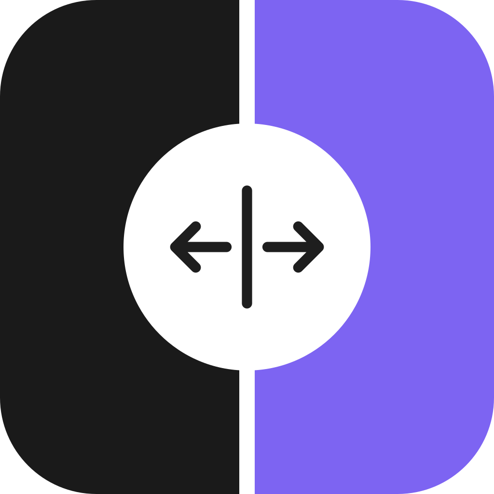

  

  <a href="https://deltavision.app">Website</a> •
  <a href="https://deltavision.app/changelog">Changelog</a> •
  <a href="https://github.com/impaktfull/delta_vision/issues">Issues</a>

# DeltaVision

> Visual diff for Git-tracked images. DeltaVision detects the images that changed in your Git
> repository and shows you exactly what changed, pixel by pixel, commit by commit. Built for
> reviewing Flutter golden test changes.

Download the app at [deltavision.app](https://deltavision.app).

## Issues and ideas

This repository is the public home of DeltaVision: the place to report a bug or ask for a feature.
The source code of the app and the platform is closed.

- **Found a bug?** [Open a bug report](https://github.com/impaktfull/delta_vision/issues/new?template=bug_report.yml).
- **Missing something?** [Suggest a feature](https://github.com/impaktfull/delta_vision/issues/new?template=feature_request.yml).
- **A question about your licence or an invoice?** Mail [hello@impaktfull.com](mailto:hello@impaktfull.com).
  Never put licence keys or invoice details in an issue: issues are public.

---

DeltaVision is made by [impaktfull](https://impaktfull.com).
